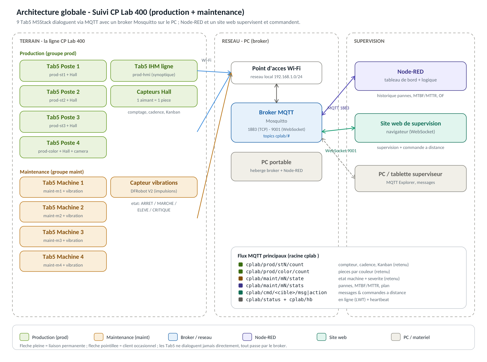

# CPLab Tracking: IIoT on a Festo CP Lab 400 line

> **Built on [invethic/WirelessIoT-LAB2](https://github.com/invethic/WirelessIoT-LAB2).**
> That repository is the lab baseline: production and maintenance tracking for the line, with
> the Tab5 firmware, the Node-RED flows and the web supervision site. This repository starts
> from it, reorganises it, and adds what our student group built on top: **keeping the data
> alive when the MQTT broker goes down.**

A small production line makes smartphone cases. Nine M5Stack Tab5 screens watch it: five count pieces, check colours and run Kanban, four listen to the machines' vibrations to spot breakdowns. Everything they see goes through one MQTT broker (local in our case, but can be cloud-based), to a Node-RED dashboard and a web site.

It works nicely, until someone asks the question:
**what happens to the data when the broker stops?**



*Overall architecture (labels in French): the Tab5s on the line, the laptop running Mosquitto
and Node-RED, and the supervision clients. The Tab5s never talk to each other: everything goes
through the broker.*

---

## Contents

- [The lab in one page](#the-lab-in-one-page)
- [Our group's challenge: surviving a broker outage](#our-groups-challenge-surviving-a-broker-outage)
- [What you will learn here](#what-you-will-learn-here)
- [Try it in 10 minutes, without hardware](#try-it-in-10-minutes-without-hardware)
- [What's in the repository](#whats-in-the-repository)
- [Reference: topics, Kanban, maintenance, wiring](#reference)
- [Setup on the real line](#setup-on-the-real-line)
- [Known limits](#known-limits)
- [Credits and license](#credits-and-license)

---

## The lab in one page

The Festo CP Lab 400 is a 4-station production line. We add a non-intrusive IIOT (Industrial Internet of Things) layer on top, to monitor the line and record additional data.
Each station gets a Tab5 (ESP32-P4, 5” touch screen, Wi-Fi through an ESP32-C6) and a sensor:

| Group | Tab5 | Sensor | What it does |
|---|---|---|---|
| Production | `prod-st1` to `prod-st3` | Hall sensor (1 magnet = 1 piece) | Counts pieces, cycle time vs takt, Kanban with the next station |
| Production | `prod-color` | Hall sensor + camera | Station 4: counts and classifies colours (red, green, blue, black) |
| Production | `prod-hmi` | none | Operator panel: line synoptic, order progress, Andon buttons |
| Maintenance | `maint-m1` to `maint-m4` | Vibration sensor | RUN / OFF / ABNORMAL, breakdowns over 24 h and 7 days, MTBF / MTTR |

On the laptop, **Mosquitto** is the broker (MQTT on port 1883, WebSockets on 9001), **Node-RED**
keeps the breakdown history and serves the dashboards, and a **web page** supervises and sends
orders and messages to the Tab5s.


## Our group's challenge: survive a broker outage

Our group’s objective was to improve the production line reliability. So we thought, what if the MQTT broker goes down for some reason? Every message goes through it. Stop Mosquitto for 20 seconds and the counts produced in those 20 seconds are simply gone.

In a group of three (A: firmware, B: web and HMI, C: Node-RED and broker), we wrote a specification
to lay down the expected behavior: [docs/spec-mqtt-outage-handling-v5.md](docs/spec-mqtt-outage-handling-v5.md).

In short:

| Outage | What the Tab5 does |
|---|---|
| Under 15 s | Keeps its messages in a local buffer, replays them when the broker is back |
| 15 s or more | Switches to a second path, **OPC UA**, straight to Node-RED |
| Broker back | Waits 5 s to be sure, replays what's left, goes back to MQTT |

Every message carries a number, `seq`, so Node-RED can **count** what was sent and what arrived.
The count is verifiable on a dashboard.

Building it taught us more than the spec expected. Three findings stand out:

1. **"Publish OK" doesn't mean "delivered".** With QoS 0, the network stack accepts the data
   even when the broker is frozen. A Tab5 would only notice the outage after 15 to 30 s, too late
   to switch at 15 s. Our fix: each Tab5 subscribes to its own status message and watches for
   the echo. No echo for 3 s means the link is gone.
2. **The receiver can lose data too.** After a broker restart, Node-RED took 15 s to reconnect
   and missed the replayed messages. A persistent MQTT session, and a broker told to keep QoS 0
   messages for absent clients, closed that gap.
3. **Testing needs its own tools.** Restarting the broker takes 1–2 s, enough to turn a "14 s"
   test into a 16 s one. So the fault-injection script can also *freeze* the broker, for exact
   durations.

**Where it stands** (simulated Tab5s, Nov 19, 2026):

| Acceptance test | Result |
|---|---|
| 10 s outage | 0 messages lost, back on MQTT in 6–8 s |
| 14 s outage | 0 lost, stays on MQTT (correct) |
| 16 s outage | 0 lost, switches to OPC UA at 15.7 s (target 15 ± 2 s) |
| 40 s outage | Production dashboard keeps counting through OPC UA, 0 lost |

The laptop side (Node-RED, broker, tests) is done. The Tab5 firmware and the website's switch to
the Node-RED relay are the group's next steps, before the demo on Dec 2.

## What you will learn here

This repository is a good place to:

- **Read an MQTT topic design** that works: retained states, events, Last Will, heartbeats,
  commands addressed to one device, a group or everyone (see the [topic map](#mqtt-topic-map)).
- **See why QoS 0 is fragile**, and what it really takes to guarantee delivery on top of it:
  buffering, sequence numbers, duplicates, persistent sessions.
- **Compare two industrial protocols**: MQTT (publish/subscribe through a broker) and OPC UA
  (a server holding variables), used side by side.
- **Test timing rules properly**: the reliability logic is a 300-line Python model with
  11 unit tests on a fake clock, so a "16 s outage" runs in milliseconds
  ([simulator/](simulator/)).
- **Inject faults on purpose**: stop, freeze or firewall the broker with one command, and
  measure the result ([scripts/](scripts/)).

## Try it in 10 minutes, without hardware

You need a laptop (Linux or MacOS) with Mosquitto, Node-RED (with `@flowfuse/node-red-dashboard` and
`node-red-contrib-opcua`) and Python 3.11+. On Linux, follow [docs/linux-setup.md](docs/linux-setup.md).

1. Use [mosquitto/mosquitto.conf](mosquitto/mosquitto.conf) for the broker, set
   `mqttReconnectTime: 2000` in Node-RED's `settings.js`, and import
   [nodered/cplab_flows.json](nodered/cplab_flows.json). Details in [nodered/README.md](nodered/README.md).
2. Start Node-RED from this folder, so the test buttons find the outage script:
   ```bash
   CPLAB_REPO="$PWD" node-red
   ```
3. Start seven simulated Tab5s:
   ```bash
   cd simulator && python3 -m venv .venv && .venv/bin/pip install -r requirements.txt
   ```
   ```bash
   .venv/bin/python device_sim.py --dev prod-st1 --dev prod-st2 --dev prod-st3 --dev prod-color --dev prod-hmi --dev maint-m1 --dev maint-m2 --opc opc.tcp://localhost:4840/
   ```
4. Open `http://localhost:1880/dashboard`. The **Production** page comes alive. On the
   **Fiabilite** page, press **16 s (freeze)** and watch the Tab5s switch to OPC UA, come back
   and replay, then get a PASS / FAIL per device.

Prefer to start smaller? The "CPLab Simulator" tab in Node-RED fakes the whole line without
Python ("Start simulation"), which is enough to explore Kanban and the dashboards.

## What's in the repository

| Folder | What | Used for |
|---|---|---|
| `firmware/CPLab_ProdStation` | Hall counting, cadence vs takt, Kanban WIP to next station | 3 Tab5 (`STATION_NUM` 1, 2, 3) |
| `firmware/CPLab_ColorStation` | Station 4: Hall trigger + camera colour classification, calibration | 1 Tab5 |
| `firmware/CPLab_HMI` | Local operator panel: synoptic, OF progress, KPIs, Andon | 1 Tab5 |
| `firmware/CPLab_Maint` | Vibration → RUN / OFF / ABNORMAL, breakdowns 24 h / 7 days, planned actions | 4 Tab5 (`MACHINE_NUM` 1..4) |
| `nodered/cplab_flows.json` | 5 tabs: Production, Maintenance, Supervision, Simulator, Reliability (OPC UA server, seq loss check, WebSocket relay, outage tests) + dashboard ([nodered/README.md](nodered/README.md)) | Node-RED |
| `web/index.html` + `mqtt.min.js` | Web supervision and remote control (no server needed) | Browser |
| `web/Festo_Command_Center.html` | Reliability view: link state, buffer, replay, Node-RED relay | Browser |
| `mosquitto/mosquitto.conf` | Broker with MQTT 1883 + WebSockets 9001, persistence, queue for Node-RED | Laptop |
| `scripts/outage.sh` | Fault injection: stops, freezes or cuts the broker for N seconds ([scripts/README.md](scripts/README.md)) | Laptop (macOS or Linux) |
| `simulator/` | Simulated Tab5s with the outage handling, `seq` loss monitor, OPC UA test server ([simulator/README.md](simulator/README.md)) | Laptop, without hardware |
| `tests/` | Logs written by `outage.sh` and by the dashboard test buttons | Test evidence |
| `docs/` | Outage-handling spec, [Linux setup guide](docs/linux-setup.md), Wireshark teaching capture | Reference |
| `media/` | Architecture and reliability diagrams, screenshots | README / slides |

`cplab_common.h` is identical in every sketch folder (Wi-Fi via the ESP32-C6, MQTT, LWT,
heartbeat, supervisor messages, identify/reboot, UI helpers). Edit the copy in `firmware/` and
copy it into the four folders.

---

## Reference

### MQTT topic map

`TOPIC_ROOT = cplab`

| Topic | Publisher | Retained | Payload |
|---|---|---|---|
| `cplab/prod/st1..st4/count` | stations | yes | `{st,id,name,count,cycle_ms,cadence,takt_s,wip_out,wip_max,kanban,state}` |
| `cplab/prod/color/count` | prod-color | yes | `{RED,GREEN,BLUE,BLACK,UNKNOWN,total}` |
| `cplab/prod/color/last` | prod-color | no | `{color,r,g,b,dist}` |
| `cplab/prod/order` | Node-RED / web | yes | `{of,qty:{RED,GREEN,BLUE,BLACK},takt_s,wip_max}` |
| `cplab/prod/andon` | prod-hmi | no | `{from,type:"supervisor"\|"quality"}` |
| `cplab/maint/m1..m4/state` | maint Tab5 | yes | `{state:"RUN"\|"OFF"\|"ABNORMAL",reason,activity,cv,th_off,th_high,since_s,sim}` |
| `cplab/maint/m1..m4/stats` | Node-RED | yes | `{day,week,mtbf_h,mttr_min,next_prev:{date,task},next_cur:{date,task}}` |
| `cplab/maint/m1..m4/plan/set` | Node-RED / web | no | `{prev:{date,task},cur:{date,task}}` |
| `cplab/maint/m1..m4/ack` | Tab5 / web | no | `{id,by}` |
| `cplab/status/<devId>` | all Tab5 (LWT) | yes | `online` / `offline` |
| `cplab/hb/<devId>` | all Tab5 | no | `{id,role,group,title,ip,rssi,up,fw,heap}` every 10 s |
| `cplab/cmd/<target>/msg` | Node-RED / web | no | `{text,from,level:"info"\|"warn"\|"alarm",duration}` |
| `cplab/cmd/<target>/action` | Node-RED / web | no | `{cmd:"identify"\|"reboot"\|"reset"\|"learn"\|"sim_fault"\|...}` |
| `cplab/ack/<devId>` | Tab5 | no | `{id,text}` (message displayed) |
| `cplab/rel/<devId>/status` | all Tab5 (outage handling) | yes | `{state,path,buffer,capacity,dropped,seq,...}` every second, see spec section 8 |

`<target>` is a device id (`prod-st1`, `prod-st2`, `prod-st3`, `prod-color`, `prod-hmi`,
`maint-m1`…`maint-m4`), a group (`prod`, `maint`) or `all`. With the outage handling, every data
payload also carries `seq` (and `ts`, `replayed` when it was replayed); existing fields don't change.

The Kanban logic runs on each station itself (it subscribes to the next station's count), so the
line keeps working even if Node-RED is stopped. Node-RED is the source of truth only for the
breakdown history and the maintenance plan.

### Kanban rules (production stations)

WIP in the buffer between station n and n+1 = `count(n) − count(n+1)`, compared with `wip_max`
from the OF.

| WIP | Colour | Instruction on the Tab5 |
|---|---|---|
| < WIP max | green | PRODUIRE |
| = WIP max | amber | LIMITE ATTEINTE |
| > WIP max | red | STOP KANBAN (overproduction) |
| < 0 | amber | ECART COMPTAGE (sensor problem) |

The cycle time (mean of the last 6 pieces) is compared with the takt time: green ≤ takt, amber
≤ 1.15 × takt, red above (bottleneck). Station 1 also shows the OF progress and turns blue when
the OF quantity is reached.

### Maintenance state detection

The vibration sensor's digital output is sampled at 1 kHz. Each second an activity index is
computed: `max(transitions per second, % of time active)`, or the AC RMS if an analog output is
wired (`VIB_AO_PIN`). OFF below `th_off`, ABNORMAL above `th_high` (excessive) or when std/mean
over 10 s exceeds `CV_ABNORMAL` (irregular), RUN otherwise, each with a confirmation delay.
"Apprendre normal" measures 10 s on a correctly running machine and sets the thresholds.
"Simuler panne" / "Simuler arret" force a state for 20 s for training. A breakdown = a
transition to ABNORMAL; Node-RED counts them over rolling 24 h and 7 days and computes MTTR and a
rough MTBF.

### Wiring: read before connecting

The ESP32-P4 GPIOs are 3.3 V only, and the Grove port supplies 5 V. A sensor module powered at
5 V with an on-board pull-up will put 5 V on the GPIO.

- Hall sensor A3144 / KY-003: the A3144 needs ≥ 4.5 V. Power it at 5 V and either remove the
  module's pull-up resistor (the firmware enables the internal pull-up to 3.3 V; the output is
  open collector) or add a divider on the signal (10 kΩ series, 20 kΩ to GND). A 3.3 V-capable
  Hall switch avoids the problem.
- Vibration SW-420 / 801S (LM393): works at 3.3 V, power it from 3.3 V. Inductive modules
  (5–15 V, e.g. DFRobot SEN0433): power at 5 V and use a divider on DO. Set `VIB_ACTIVE_LOW`
  according to your board (most SW-420: HIGH while vibrating).
- Default pin is G53 (Grove Port A). Any free GPIO of the Tab5 expansion header works; check the
  pinout on docs.m5stack.com before choosing.
- Glue a small magnet on each piece carrier (or piece) so the Hall sensor sees one pulse per
  piece; tune `MIN_PIECE_INTERVAL_MS` so a single passage counts once.

### Colour station (camera)

The Tab5 camera (MIPI-CSI) is driven through Espressif `esp_video` (V4L2 API) in
`tab5_camera.h`. This is the part to validate first on hardware: if the core does not ship
`esp_video`, or its structures differ, the station shows "Camera indisponible" and the four
colour buttons register pieces instead, so the rest of the project is not blocked. Calibration:
press "Calibrer", place a piece of the colour under the camera, press the colour button.
References are stored in NVS. Fixed lighting and a neutral background under the camera make the
classification far more reliable. Fallback hardware option if the camera is not usable: an
M5Stack Color Unit (TCS3472, I2C) on Port A.

### Splitting the work between students (baseline lab)

Production team (SNPI / AR4): Hall wiring and debounce, station firmware, colour calibration,
HMI. Maintenance team: vibration wiring, threshold learning, state machine tuning, breakdown
statistics in Node-RED, maintenance plan. Integration: topic contract (table above), Node-RED
dashboard, web site.

BTS ATI 2nd year (Kanban, Organisation Industrielle) can work only with the Node-RED simulator
and the web site at first: change `wip_max` and takt, observe where the line blocks, identify the
bottleneck (station 3 is slower by design in the simulator), compute the required takt from a
customer demand, compare cadence to takt per station, and propose a buffer sizing. Then repeat on
the real line with the Tab5 stations.

## Setup on the real line

1. **Mosquitto**: install, copy `mosquitto/mosquitto.conf`, restart the service, open ports
   1883 and 9001 in the laptop firewall (and 1880, 4840 for Node-RED and OPC UA).
2. **Arduino IDE**: board "M5Tab5" (m5stack esp32 core 3.2.x), PSRAM enabled. Libraries:
   M5Unified, M5GFX, PubSubClient, ArduinoJson 7. In each sketch folder, copy `config.example.h`
   to `config.h` (ignored by Git), set the Wi-Fi, the laptop IP, and the station / machine
   number, then flash. Board manager URLs:
   ```
   https://espressif.github.io/arduino-esp32/package_esp32_index.json
   https://static-cdn.m5stack.com/resource/arduino/package_m5stack_index.json
   ```
3. **Node-RED**: install `@flowfuse/node-red-dashboard` and `node-red-contrib-opcua` from the
   palette, set `mqttReconnectTime: 2000` in `settings.js`, import `cplab_flows.json`, deploy
   (details in [nodered/README.md](nodered/README.md)). Dashboard at
   `http://<laptop>:1880/dashboard`. To keep the breakdown history across restarts, add to
   `settings.js`:
   ```js
   contextStorage: { default: { module: "localfilesystem" } },
   ```
4. **Web site**: open `web/index.html` in a browser (double-click works), or serve it from
   Node-RED by setting `httpStatic` to the `web` folder. Enter `ws://<laptop-ip>:9001` and connect.
5. **Without the line**: on the "CPLab Simulator" tab, click "Start simulation". All dashboards,
   the web site and the HMI Tab5 come alive with coherent data. Stop it and reset the counts
   before using the real line, because the simulator overwrites the retained counts.

## Known limits

- Firmware written for the m5stack esp32 core 3.2.x but not compiled in this package; expect
  small fixes on first build (pin choices, camera driver). The outage handling is not in the
  firmware yet: today it runs in the simulated Tab5s ([simulator/](simulator/)).
- Tab5 screen texts are without accents (GFX free fonts are ASCII).
- `cplab/prod/stN/count` is retained: after a test, reset the counters ("Remettre les compteurs a
  zero") so stations and dashboards restart from zero.
- During an outage, commands sent *to* the Tab5s (orders, messages, actions) still need MQTT.
- The Wireshark capture in `docs/captures/` is a fabricated teaching capture; its credentials
  are examples.

## Credits and license

- Baseline lab: [invethic/WirelessIoT-LAB2](https://github.com/invethic/WirelessIoT-LAB2)
  (firmware, Node-RED flows, web site, Mosquitto configuration, teaching capture).
- Outage handling, simulator, fault-injection tools and repository organisation: our student
  group (A, B, C), November 2026.

MIT License, see [LICENSE](LICENSE). The original copyright notice is kept, as the MIT license
requires.
